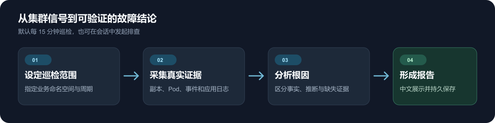
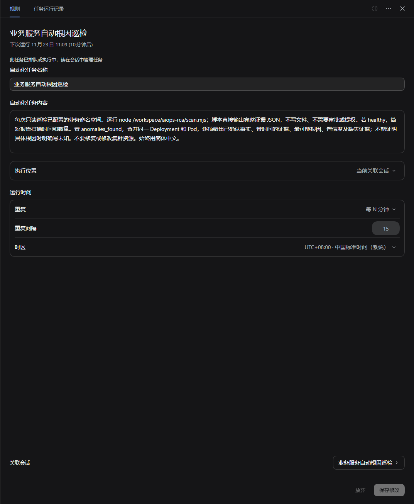
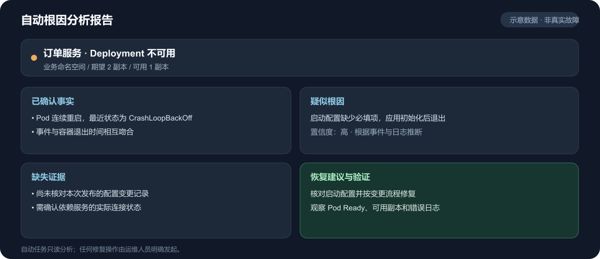

# AIOps 运维工作台

面向私有化 Kubernetes 集群的 AI 运维工作台。运维人员可以在浏览器中用自然语言查询和管理集群；定时巡检会采集真实状态、事件与日志，形成可追溯的中文故障分析。产品以镜像、Kubernetes 清单和安装脚本交付，可并入现有一键部署包。



## 主要功能

| 功能 | 使用方式 | 当前能力 |
| --- | --- | --- |
| 集群运维对话 | 在浏览器中描述排障或管理任务 | 通过 Kubernetes MCP、kubectl、Helm 查询资源、查看日志与事件；明确下达变更指令后可执行管理操作 |
| 自动根因巡检 | 安装后自动创建任务，也可在会话中手动触发 | 默认每 15 分钟检查指定业务命名空间，发现异常 Pod、不可用工作负载并关联近期证据 |
| 证据化中文报告 | 在巡检会话中查看结果 | 按故障合并 Deployment 与 Pod，区分已确认事实、疑似根因、缺失证据、恢复建议和验证步骤 |
| 运维案例与历史 | 打开工作区中的“运维案例”“巡检记录” | 首次部署预置两个排障案例；会话、任务和工作区数据保存在宿主机目录，Pod 重建后继续使用 |
| 私有化交付 | 将交付包并入现有安装脚本 | 支持 amd64、arm64 镜像归档，按架构选包；固定账号登录，连接内部 OpenAI 兼容模型接口 |

自动巡检只读，不自行修复或修改集群资源。交互式管理操作由运维人员明确发起；工作台在集群中使用管理员权限，应仅向授权人员开放入口。

## 产品界面

### 定时巡检任务

安装后可在工作台查看任务规则、下次运行时间及任务记录。任务默认每 15 分钟运行一次，巡检范围由安装参数指定。



### 根因报告

报告先列出集群可核实的事实，再给出推断与待核对项；下面的服务名称和数据仅用于展示报告结构。



## 部署

交付包中的 `install.sh`、`harness.yaml`、amd64 与 arm64 两份镜像归档及各自同名的 `.sha256` 文件放在同一目录。目标节点需要 Docker、kubectl、openssl，安装脚本会校验并导入镜像、创建登录配置、部署到 Kubernetes 并等待工作负载就绪。**部署时无需再下载 kubectl、Helm 或工作台依赖。**

```bash
cd delivery/aiops-v15
AIOPS_NODE_IP='<浏览器访问的节点 IP>' \
AIOPS_MODEL_BASE_URL='<OpenAI 兼容接口基础 URL>' \
AIOPS_MODEL_ID='<模型 ID>' \
AIOPS_DATA_DIR='<宿主机持久化绝对路径>' \
AIOPS_RCA_NAMESPACES='<业务命名空间，多个用逗号分隔>' \
bash install.sh
```

单节点集群自动选择数据节点；多节点集群还需设置 `AIOPS_STORAGE_NODE`，并确保镜像已加载到该节点。首次安装可传入 `AIOPS_USERNAME`、`AIOPS_PASSWORD`；未指定密码时脚本会生成并打印。当前内部模型接口无需 API Key；更换为需要鉴权的接口时，可在安装提示中填写或预设 `AIOPS_MODEL_API_KEY`。密钥保存在 Kubernetes Secret 中。浏览器入口为 `http://<节点 IP>:31884/`，使用说明位于 `/guide`。

`<AIOPS_DATA_DIR>/data` 保存会话、定时任务和设置，`<AIOPS_DATA_DIR>/workspace` 保存工作区文件；两者通过 `hostPath` 挂载。执行 `bash uninstall.sh` 会卸载本产品的集群资源，保留宿主机数据。完整参数、镜像构建、验收和分支流程见 [交付与开发说明](deploy/aiops/BUILDING.md)。

## 仓库

产品定制代码位于 [`deploy/aiops/`](deploy/aiops/)；镜像归档、密码、Secret 和会话数据不纳入 Git。底层项目的原始说明保存在 [上游文档](README.upstream.md)，便于后续合并更新。
